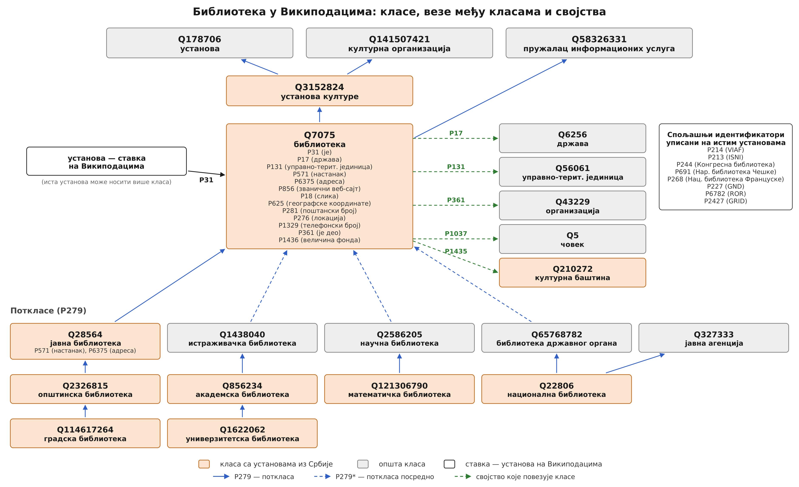

# Онтологија библиотека у Википодацима

Машински читљив опис класа, веза и својстава којима су библиотеке описане у
Википодацима, са програмом који из тог описа црта дијаграм.

Дијаграм је настао уз рад *Шта нам говоре подаци о српским библиотекама у
слободној енциклопедији Википедија?* (Читалиште, 2026). У раду је објављена
верзија означена ознаком `v1.0`; овде се онтологија и даље допуњује.



## Шта је где

| путања | садржај |
|---|---|
| `rad/` | Слика 2 **тачно онаква каква је предата уз рад**, непромењена (SVG, PDF, PNG 600 dpi) |
| `slike/` | остале слике из рада, са записом порекла у `slike/izvori.csv` |
| `podaci/klase.csv` | класе — један ред по правоугаонику на слици |
| `podaci/veze.csv` | стрелице међу класама |
| `podaci/svojstva.csv` | својства и спољашњи идентификатори |
| `crtaj.py` | програм који из тих табела црта слику |
| `izlaz/` | нацртане слике: SVG, PDF и PNG од 600 dpi |
| `provera/provera_qid.rq.txt` | SPARQL упити за проверу свих QID-ова и веза |

Фасцикла `rad/` се не мења — то је запис онога што је објављено. Онтологија
која расте живи у `podaci/`, а из ње настаје `izlaz/`.

## Како се слика поново црта

```bash
pip install -r zahtevi.txt
python crtaj.py
```

Постоје два распореда из истих података:

```bash
python crtaj.py --raspored sirok      # распоред као на слици из рада (водораван)
python crtaj.py --raspored uspravan   # усправан, стаје у страну часописа
python crtaj.py --raspored sirok --sirina 6000   # друга резолуција PNG-а
```

Водоравни распоред расте надоле и у ширину како се онтологија шири, па је
погодан за екран и за репозиторијум. Усправни стаје у ширину слога часописа.

Распоред се у оба случаја рачуна сам: свака класа која води стрелицом ка
корену (`Q7075`) почиње нову грану, а грана се продужава пратећи стрелице
`P279`. Стрелице се секу тачно на ивицама правоугаоника, па их не треба ручно
намештати.

## Како се онтологија допуњује

Уређују се табеле, не програм.

**Нова класа** — ред у `podaci/klase.csv`:

```csv
Q7184713,школска библиотека,srbija,pot,12,
```

| колона | значење |
|---|---|
| `qid` | идентификатор ставке на Википодацима |
| `naziv` | назив у правоугаонику; `\|` прелама ред |
| `grupa` | `srbija` (класа са установама из Србије, окер), `opsta` (сива), `stavka` (бела) |
| `zona` | `nad` врх хијерархије · `medju` међукласа · `koren` библиотека · `stavka` појединачна установа · `pot` стабло поткласа · `veza` класа повезана својством |
| `redosled` | редослед унутар зоне |
| `svojstva` | додатни редови у кутији, одвојени знаком `;` |

**Нова веза** — ред у `podaci/veze.csv`:

```csv
Q7184713,Q7075,P279,
```

`vrsta` је `P279` за непосредну поткласу, `P279*` за посредну (испрекидана
линија), `P31` за однос ставке и класе, или код својства (`P17`, `P131`…) за
класу у зони `veza`.

**Ново својство** — ред у `podaci/svojstva.csv`, где је `blok` или `ustanova`
или `identifikator`.

Након сваког гурања измена на GitHub, радни ток у `.github/workflows/crtaj.yml`
поново црта слику и качи је као артефакт, па се одмах види да ли нешто штрчи.

## Провера тачности

Називи и везе на слици морају да одговарају стању на Википодацима. У
`provera/provera_qid.rq.txt` су два упита за
[query.wikidata.org](https://query.wikidata.org):

1. враћа српску и енглеску ознаку и опис за сваки QID са слике;
2. за сваку нацртану стрелицу враћа да ли веза `P279` заиста постоји
   непосредно (`neposredno`) или посредно (`posredno`).

Ако је за неки ред и једно и друго `false`, та веза на слици не постоји на
Википодацима и треба је уклонити из `podaci/veze.csv`.

Пет класа нема српску ознаку на Википодацима, па су називи на слици преводи
енглеских ознака: `Q141507421`, `Q58326331`, `Q114617264`, `Q121306790` и
`Q65768782`. Ако упит покаже да је српска ознака у међувремену додата,
најбоље је употребити њу.

## Позивање

Верзија употребљена у раду означена је као `v1.0`. Кроз повезивање са
[Zenodo](https://zenodo.org) свако издање добија свој DOI, па се у раду наводи
непроменљиви снимак, док се репозиторијум и даље допуњује.

## Услови коришћења

Код: MIT. Подаци и слике: CC BY 4.0. Називи класа и својстава потичу са
Википодатака (CC0 1.0). Видети `LICENSE`.
