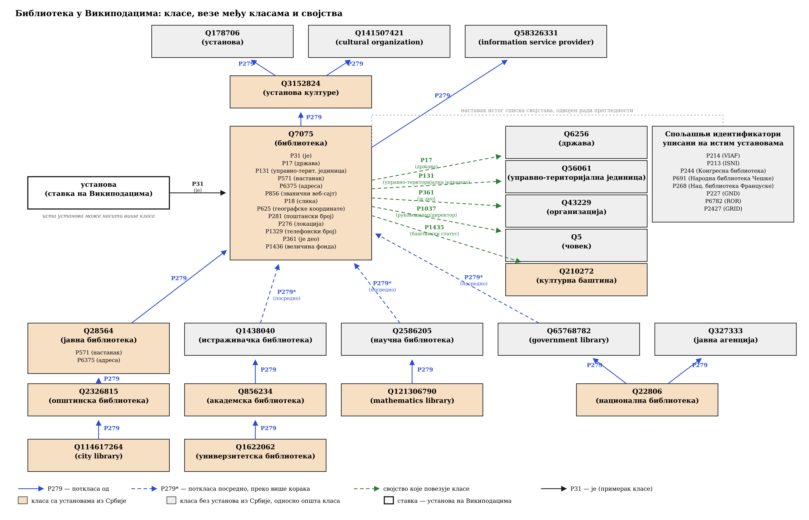

# Онтологија библиотека у Википодацима



Дијаграм приказује како су библиотеке описане у Википодацима: класе којима
установа може припадати, везе међу тим класама преко својства P279 (поткласа),
својства уписана на самим установама и спољашње идентификаторе под којима се
исте установе воде у другим базама. Окером су означене класе под којима постоје
установе из Србије, сивом опште класе, а белим оквиром појединачна установа као
ставка на Википодацима.

Слика је настала уз рад *Шта нам говоре подаци о српским библиотекама у
слободној енциклопедији Википедија?*, Читалиште, 2026.

## Упити

Упити се покрећу на [query.wikidata.org](https://query.wikidata.org). Подаци се
мењају како их заједница допуњује, па резултат неће увек бити истоветан ономе
који је наведен у раду.

**Наткласе библиотеке** — горњи део слике:

```sparql
SELECT ?nadklasa ?nadklasaLabel WHERE {
  wd:Q7075 wdt:P279+ ?nadklasa .
  SERVICE wikibase:label { bd:serviceParam wikibase:language "sr,sr-el,en". }
}
```

**Поткласе библиотеке, са непосредном наткласом сваке** — доњи део слике:

```sparql
SELECT ?potklasa ?potklasaLabel ?nadklasa ?nadklasaLabel WHERE {
  ?potklasa wdt:P279+ wd:Q7075 ;
            wdt:P279 ?nadklasa .
  SERVICE wikibase:label { bd:serviceParam wikibase:language "sr,sr-el,en". }
}
ORDER BY ?nadklasaLabel ?potklasaLabel
```

**Сва својства једне установе** — упит са Слике 3 у раду, овде за Народну
библиотеку Србије:

```sparql
SELECT ?svojstvoId ?svojstvoLabel ?vrednostLabel WHERE {
  VALUES ?ustanova { wd:Q945496 }
  ?ustanova ?p ?vrednost .
  ?svojstvo wikibase:directClaim ?p .
  BIND(STRAFTER(STR(?svojstvo), "entity/") AS ?svojstvoId)
  SERVICE wikibase:label { bd:serviceParam wikibase:language "sr,sr-el,en". }
}
ORDER BY ?svojstvoId
```

**Библиотеке у Србији и број језичких издања у којима постоји чланак о њима:**

```sparql
SELECT ?ustanova ?ustanovaLabel (COUNT(DISTINCT ?clanak) AS ?brojIzdanja) WHERE {
  ?ustanova wdt:P31/wdt:P279* wd:Q7075 ;
            wdt:P17 wd:Q403 .
  ?clanak schema:about ?ustanova .
  FILTER(CONTAINS(STR(?clanak), ".wikipedia.org"))
  SERVICE wikibase:label { bd:serviceParam wikibase:language "sr,sr-el,en". }
}
GROUP BY ?ustanova ?ustanovaLabel
ORDER BY DESC(?brojIzdanja)
```

**Библиотеке у Србији које имају унете координате** — први ред упита каже
Википодацима да резултат прикаже као мапу:

```sparql
#defaultView:Map
SELECT ?ustanova ?ustanovaLabel ?koordinate WHERE {
  ?ustanova wdt:P31/wdt:P279* wd:Q7075 ;
            wdt:P17 wd:Q403 ;
            wdt:P625 ?koordinate .
  SERVICE wikibase:label { bd:serviceParam wikibase:language "sr,sr-el,en". }
}
```

---

Садржај овог репозиторијума сме се користити уз навођење oригиналног рада аутора: Милица Иконић
Нешић, Анђела Стошић и Биљана Рујевић.
